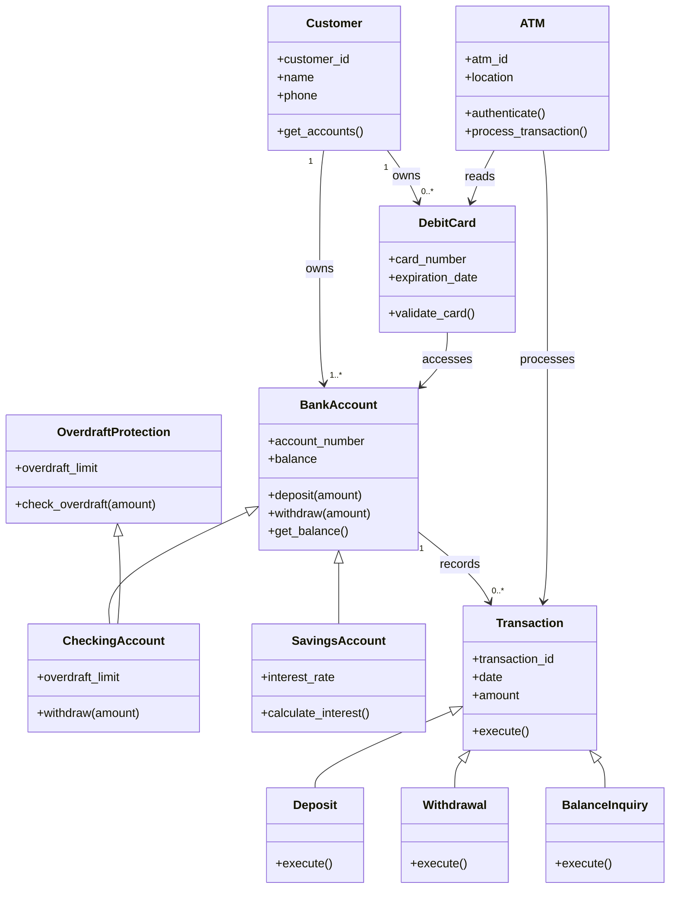

# Banking System – Class Diagram

## Problem and Scope

The problem addressed by this project is managing basic banking operations through a banking system. Customers need a convenient and secure way to access their accounts, check their balances, deposit money, and withdraw money. An ATM system helps customers perform these operations without needing to visit a bank teller.

The scope of this solution includes customers, bank accounts, ATM machines, debit cards, and transactions. The system will support checking and savings accounts, deposits, withdrawals, and account balance inquiries. It will also include overdraft protection for checking accounts. The purpose of the class diagram is to organize the system into reusable classes and demonstrate how inheritance and multiple inheritance can be used in object-oriented programming.

This design uses separate classes to represent the different parts of the banking system. A parent account class provides common account information and functionality, while checking and savings accounts have their own specialized features. Transactions are organized into different types, such as deposits and withdrawals. This structure makes the program easier to maintain, expand, and reuse.

## Class Diagram

## Inheritance Examples

1. **CheckingAccount and SavingsAccount inherit from BankAccount.** Both share common account properties and methods such as account number, balance, deposits, and balance inquiries.
2. **Deposit, Withdrawal, and BalanceInquiry inherit from Transaction.** They share transaction information such as transaction ID, date, amount, and execution behavior.

## Multiple Inheritance Example

**CheckingAccount inherits from both BankAccount and OverdraftProtection.** This allows a checking account to use the common account features while also having overdraft protection behavior.
